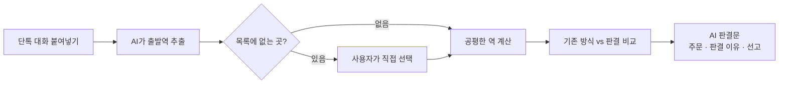
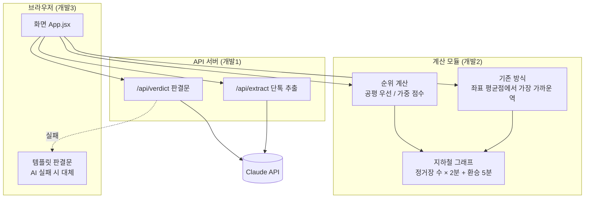
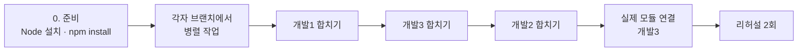

# 약속 장소 판사 — 한눈에 보기

> 세부 규칙과 작업표는 [PLAN.md](PLAN.md)에 있습니다. 이 문서는 "무엇을, 왜, 누가, 어떤 순서로" 만드는지 빠르게 파악하기 위한 요약입니다.

## 무엇을 만드나요?

**단톡 대화를 붙여넣으면, 모두에게 공평한 약속 역을 계산해서 법정 판결문으로 알려 주는 웹앱**

| 기존 방식 😩 | 우리 앱 ⚖️ |
|---|---|
| 지도상 "중간쯤"으로 정함 → 한 명만 멀리 옴 | **가장 오래 걸리는 사람의 시간**부터 줄이는 역을 추천 |
| 단톡에서 "어디서 와?"가 수십 개 오감 | 대화를 붙여넣으면 AI가 출발역을 채워 줌 |
| 왜 거기인지 근거가 없음 | 사람별 이동시간·환승을 표로 보여 주고, 기존 방식과 비교 |

## 사용 흐름

## 어떻게 동작하나요?

- **API 키는 서버에서만** 사용합니다. 브라우저에는 키가 절대 들어가지 않습니다.
- **AI는 숫자를 만들지 않습니다.** 모든 시간은 계산 모듈이 만들고, AI는 대화를 읽고 판결문을 씁니다.
- 키가 없거나 AI가 실패해도 **템플릿 판결문과 수동 입력으로 끝까지 동작**합니다.

## 누가 무엇을 하나요?

| | 개발1 · 서버·Claude | 개발2 · 계산·데이터 | 개발3 · 화면 |
|---|---|---|---|
| 브랜치 | `dev1-server` | `dev2-calc` | `dev3-ui` |
| 핵심 작업 | API 서버, Claude 판결문, 단톡 추출 | 지하철 그래프, 순위, 기존 방식 계산 | 단톡 입력, 결과 표, 비교 카드, 판결문 카드 |
| 담당 파일 | `server/`, `vite.config.js`, `package.json` | `src/ranking.js`, `src/graph.js`, `src/baseline.js`, `src/data/` | `src/App.jsx`, `src/styles.css`, `src/api.js` |

## 진행 순서

합치는 순서가 **개발1 → 개발3 → 개발2**인 이유: 계산 결과 형식이 바뀌면 기존 화면이 깨지므로, 화면을 먼저 새 형식으로 바꾼 뒤 계산을 합칩니다.

## 진행 상황

- [x] 계획 확정 (PLAN.md)
- [x] 1-0 의존성 버전 고정
- [ ] 개발1: API 서버 · Claude 판결문 · 단톡 추출
- [ ] 개발2: 계산 형식 · 기존 방식 · 지하철 데이터(사람 검증) · 그래프
- [ ] 개발3: API 호출 · 단톡 화면 · 결과 표 · 비교 카드 · 판결문 카드
- [ ] 합치기 · 연결 · 리허설

## 데모 시나리오

1. **예시 불러오기** → 샘플 단톡이 입력됨
2. **출발역 채우기** → 잠실 · 강남 · 수원은 자동, **일산은 비어 있음**
3. 사용자가 일산 대신 가까운 역을 직접 선택 → *"최종 결정은 사람이 한다"*
4. 판결 → **기존 방식 vs 우리 판결** 비교 카드
5. 판결 기준 토글로 가중 점수 방식과도 비교
6. AI 판결문 낭독 🔨

## 우리가 지키는 약속

- AI는 숫자를 만들지 않는다
- 사람이 확인한 지하철 구간만 "확인됨", 화면에는 "추정치" 표기
- 실제 데이터가 없는 기능은 넣지 않는다
- 키와 `.env`는 절대 커밋하지 않는다
