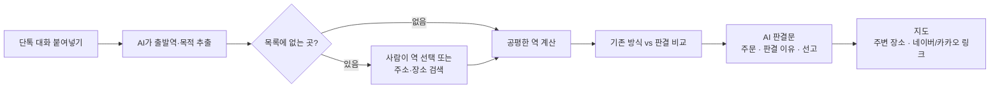
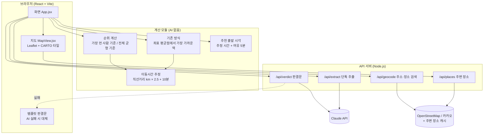
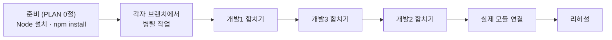

# 약속 장소 판사 — 한눈에 보기

> 이 문서는 "무엇을, 왜, 어떻게" 만들었는지 빠르게 파악하기 위한 요약입니다. 판결 기준의 자세한 설명은 [docs/CRITERIA.md](docs/CRITERIA.md), 현재 상태와 발표용 정리는 [STATUS.md](STATUS.md), 초기 계획과 작업표(기록용)는 [PLAN.md](PLAN.md)에 있습니다.

## 무엇을 만드나요?

**단톡 대화를 붙여넣으면, 모두에게 공평한 약속 역을 계산해서 법정 판결문으로 알려 주는 웹앱**

| 기존 방식 | 우리 앱 |
|---|---|
| 지도상 "중간쯤"으로 정함 → 한 명만 멀리 옴 | **가장 오래 걸리는 사람의 시간**부터 줄이는 역을 추천 |
| 단톡에서 "어디서 와?"가 수십 개 오감 | 대화를 붙여넣으면 AI가 출발역·목적을 채워 줌 |
| 왜 거기인지 근거가 없음 | 사람별 추정 이동시간·편차를 표로 보여 주고, 기존 방식과 비교 |
| 정한 뒤 갈 곳을 다시 검색 | 판결된 역 주변 카페·음식점·놀 곳을 지도로 보여 줌 |

## 사용 흐름

## 판결 기준

| 기준 | 정렬 방법 | 한 줄 설명 |
|---|---|---|
| **가장 먼 사람 기준** (기본) | 가장 오래 걸리는 사람의 시간 → 사람 간 차이 | 아무도 너무 멀리 오지 않게 |
| **전체 균형 기준** | 사람 간 차이 → 가장 오래 걸리는 사람의 시간 | 모두가 비슷하게 걸리게 |
| (비교용) 기존 방식 | 출발지 좌표의 평균점에서 가장 가까운 역 | 지도상 한가운데 |

- 이동시간은 **직선거리 km × 2.5분 + 10분으로 계산한 추정치**입니다(같은 역이면 0분). 실제 지하철 노선과 환승은 계산하지 않습니다.
- 평균 이동시간만 줄이는 방식은 한 사람만 멀리 오는 결과가 나올 수 있어 쓰지 않습니다. 자세한 이유는 [docs/CRITERIA.md](docs/CRITERIA.md)에 있습니다.

## 어떻게 동작하나요?

- **API 키는 서버에서만** 사용합니다. 브라우저에는 키가 절대 들어가지 않습니다.
- **AI는 숫자를 만들지 않습니다.** 모든 시간은 계산 모듈이 만들고, AI는 대화를 읽고 판결문을 씁니다. 판결문 속 숫자가 계산값과 다르면 버리고 템플릿으로 대체합니다.
- 키가 없거나 AI가 실패해도 **템플릿 판결문과 수동 입력으로 끝까지 동작**합니다.

## 누가 무엇을 했나요?

| | 개발1 · 서버·Claude | 개발2 · 계산·데이터·지도 | 개발3 · 화면 |
|---|---|---|---|
| 핵심 작업 | API 서버, Claude 판결문, 단톡 추출, 주소 검색, 주변 장소 | 순위 계산, 기존 방식, 출발 시각, 지도 | 단톡 입력, 결과 표, 비교 카드, 판결문 카드, 목적·예시 |
| 주요 파일 | `server/`, `vite.config.js`, `package.json` | `src/ranking.js`, `src/baseline.js`, `src/departure.js`, `src/MapView.jsx`, `src/data/` | `src/App.jsx`, `src/styles.css`, `src/api.js` |

## 진행 순서 (완료)

계획했던 개발 작업은 모두 `main`에 합쳐졌습니다. 남은 것은 리허설과 발표 준비입니다.

## 진행 상황

- [x] 계획 확정 (PLAN.md), 의존성 버전 고정
- [x] API 서버, Claude 판결문·단톡 추출, 키 유출 점검
- [x] 판결 기준 2가지(가장 먼 사람 기준 / 전체 균형 기준) + 기준 설명, 기존 방식 비교 카드
- [x] 출발지 주소·장소 검색 (`/api/geocode`)
- [x] 예시 단톡 10개
- [x] 목적 최대 3개(누른 순서가 우선순위) + 이유 한 줄
- [x] 약속 시각 입력 시 사람별 추천 출발 시각
- [x] 지도: 판결 역·기존 방식 역·출발지 + 반경 500m 주변 장소(30개 역 실데이터 캐시), 네이버 지도·카카오맵 링크
- [ ] 지도에 사람별 색깔 경로 표시 (작업 중)
- [ ] 리허설 · 발표용 화면 캡처

## 데모 시나리오

1. **예시 불러오기** → 샘플 단톡이 입력됨
2. **출발역 채우기** → 잠실 · 강남 · 수원은 자동, **일산은 비어 있음**
3. 사용자가 일산을 주소·장소 검색하거나 가까운 역을 직접 선택 → *"최종 결정은 사람이 한다"*
4. 목적과 약속 시각 입력(선택)
5. 판결 → **기존 방식 vs 우리 판결** 비교 카드
6. 판결 기준 토글로 전체 균형 기준과도 비교
7. AI 판결문 낭독
8. 지도에서 주변 장소 확인, 네이버 지도·카카오맵으로 열기

## 우리가 지키는 약속

- AI는 숫자를 만들지 않는다
- 이동시간은 직선거리 기반 추정치이며, 화면과 발표에 "추정치"로 표기한다
- 실제 데이터가 없는 기능은 넣지 않는다
- 키와 `.env`는 절대 커밋하지 않는다
